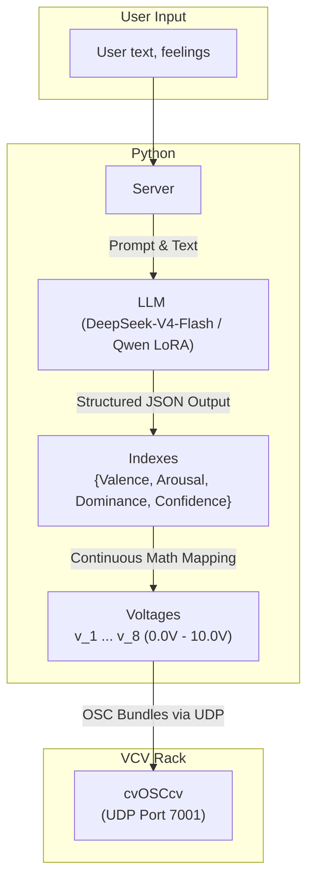
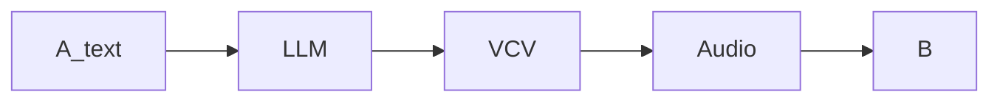
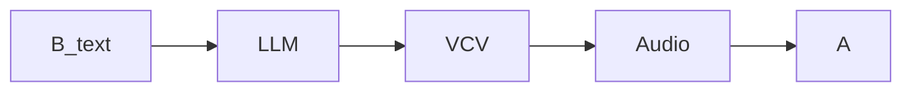

## Roles
1. Me myself will fully decide the design of this project. Meanwhile, I will give out a clear blueprint and architecture.
2. In this project, AI as an assistant was used for debugging, writing protocols, and filing.

## Project design

### Backgrounds and SQ
1. The new media theory of Mcluhan: "The medium is the message." (Was learned in the lecture in NYUSH IMA Summer Program)
2. In my daily life, most of my communications happen online. I have to admit that this is the fastest and most convenient way to exchange information, but unavoidably the message was distorted after going through media, causing misunderstandings and conflicts (Clearly I've felt it and was one being tortured by this). I miss the old way of communicating. I can see the expressions; I can feel the energy. 
3. This misunderstanding is nuanced that most people ignored it.
4. This project is to discuss and reflect this phenomenon, in an elegant way :)

## Methodology

In order to visualize this seemingly intangible feeling of misunderstanding. I decided to use VAD (Valence, Arousal, Dominance) indexes to reflect emotions / feelings. In this way, "feelings" are quantized, therefore mathematical methods can be applied. The emotions were put into a 3D axes

Ekman's categorical emotions was not used for it's discreteness. 

## Sound System design

### I/O 
Input: User's words in text
Output: Audio generated by VCV according to the text.

> there will be two parts: python for processing data, transforming the text to VAD indexes; VCV for sound generating.


### Data workflow



### Models
1. Deepseek V4.1 Flash
2. Finetune a Qwen model

to see how different model(media) affect the results.
Deepseek is theoretically smarter, with more precision. 
#### Qwen Finetuning

base model: Qwen/Qwen2.5-1.5B-Instruct

1. data processing
	1. raw data was in the format of 
	`{"text": "...", "vector": {"valence": ..., "arousal": ..., "dominance": ..., "embodiment": ..., "intentionality": ..., "source": ...}}`
		I merged embodiment, intentionality and source as confidence.(`portfolio/project2/training/prepare_data.py`)
	2. split the data in to 9:1, train : validation
2. training method (train_qwen.py)
	1. Supervised
	2. To avoid forgetting and maintain fast iteration, I use LoRA over frozen base weights
	3. **Target Modules**: All linear projection layers across attention and MLP blocks (`q_proj`, `k_proj`, `v_proj`, `o_proj`, `gate_proj`, `up_proj`, `down_proj`)
	4. Optimize (Very common cross-entropy)
	5. Evaluation (eval_and_export.py)

### Mapping

Mapping functions were set to prevent circumstances like mutes, too loud, or too quiet. 

| Ch    | OSC Address      | use              | module                     | Volts          | Mapping Functions      | Reason                                                                      |
| ----- | ---------------- | ---------------- | -------------------------- | -------------- | ---------------------- | --------------------------------------------------------------------------- |
| **1** | `/vcv/timbre`    | Cutoff Freq      | Mutable Plaits (Timbre CV) | $−3.0V∼+5.0V$  | $v1​=−3.0+8.0⋅V$       | Based on valence.<br>Positive -> bright, hi-cut<br>Negative -> dark, lo-cut |
| **2** | `/vcv/frequency` | Pitch Offset     | V/Oct Base Modulation      | $−2.0V∼+2.0V$  | $v2​=−2.0+4.0⋅A$       | Based on Arousal                                                            |
| **3** | `/vcv/amplitude` | Dynamic Loudness | VCA (Main Level)           | $+2.0V∼+10.0V$ | $v3​=2.0+8.0⋅A$        | Arousal determines the amplitude                                            |
| **4** | `/vcv/envelope`  | Decay Time       | ADSR / Envelope Gen        | $−4.0V∼+4.0V$  | $v4​=−4.0+8.0⋅(1.0−A)$ | Based on Arousal.<br><br>Hyperactive -> shorter decay<br>Calm -> longer     |
| **5** | `/vcv/mode`      | Scale / Mode     | Quantizer / Mode Select    | $−4.0V∼+4.0V$  | $v5​=−4.0+8.0⋅V$       | Low V（Minor/Dissonant） High V（Major/Lydian）                                 |
| **6** | `/vcv/chord`     | Chord Degree     | Chord Progression Gen      | $0.0V∼6.0V$    | $v6​=round(6.0⋅D)$     | Dominance determines the root                                               |
| **7** | `/vcv/type`      | Chord Complexity | Chord Type Morphing        | $0.0V∼2.0V$    | $v7​=round(2.0⋅D)$     | Dominance determines the chord type                                         |
| **8** | `/vcv/noise`     | Noise            | Noise Gen / Plateau Reverb | $0.0V∼+10.0V$  | $v8​=10.0⋅(1.0−D)$     | Dominance determines the noise                                              |

----
## Blind Test Design
 1. 2 participants
 2. double blind, both cannot see other's screen
 3. the only medium is the audio generated by VCV


Repeat
So this can generate a "conversation"

In this blind test, we need 
1. UI for both participants
2. state machine
3. datebase(SQLite)


---

## Repository Structure
```text
portfolio/project2/
├── README.md
├── LAB_REPORT.md
├── CASE_STUDIES.md          
├── start.sh                 
│
├── workflow/                
│   ├── generative template new mvp.vcv  
│   ├── web_controller_server.py         
│   ├── llm_sound_interactive.py         
│   └── local_qwen_to_vad.py             
│
├── blind_test/             
│   ├── launch_performance.sh            
│   ├── server.py                        
│   ├── state_machine.py
│   ├── acoustic_bridge.py
│   ├── real_model.py
│   ├── web/                             
│   └── data/                            
│
├── training/                
│   ├── prepare_data.py                 
│   ├── train_qwen.py                    
│   ├── eval_and_export.py               
│   └── data/                            
│
├── models/
│   └── qwen_lora/
└── protocols/               
    ├── BLIND_TEST_PLAN.md               
    ├── BLIND_TEST_DATA_SCHEMA.md
    └── BLIND_TEST_STATE_MACHINE.md 
```
## **Quickstart**

### **Prerequisites**

1. Open VCV Rack and load the modular patch: `portfolio/project2/workflow/generative template new mvp.vcv` _(Ensure the `cvOSCcv` module is active and listening on UDP port `7001`)_

### **1. Launch Double-Blind Web Experiment (2 Participants)**

To run a formal multi-round alternating conversation test between two isolated participants:

```bash
cd portfolio/project2/blind_test
./launch_performance.sh
```
- Automatically initializes a new timestamped SQLite database in `blind_test/data/`.
- Cleans stale ports (7070 / 8080) and launches the backend service.
- Automatically pops open two isolated browser windows for Participant A and Participant B.
### **2. Launch Standalone Live Controller & Visualizer**

To interact with the sound engine solo or demonstrate real-time text-to-sound modulation:

```bash
cd portfolio/project2
./start.sh
```

- Starts the Web Control Center at `http://127.0.0.1:7070`.
- Supports preset literary excerpts (Mishima, Faulkner) or custom somatic text.
- Real-time streaming of 8-channel CV voltages and audio waveforms.
