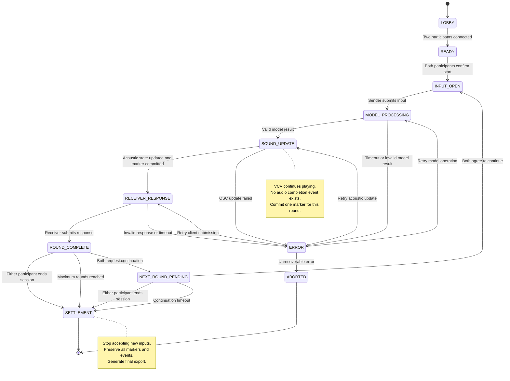
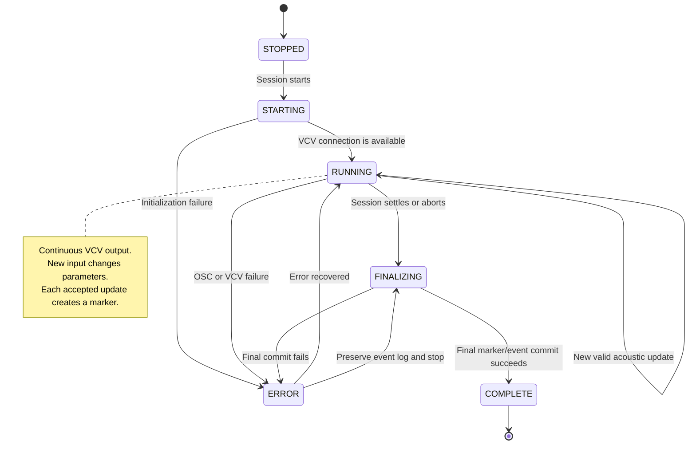

# Blind Test State Machine

## 1. Design Decision

The experiment does **not** require the server to record audio.

VCV Rack continuously produces sound. The server records the exact moment at which a new input changes the acoustic state. These timestamped markers are the authoritative temporal structure of the experiment.

Screen recording may be used as the audiovisual record of the session, but it is not part of the server-side state machine and is not required for the experiment to function.

```text
Participant input
        ↓
Server accepts event
        ↓
Model inference
        ↓
VCV parameters update
        ↓
Marker is committed
        ↓
VCV continues playing until the next accepted input
```

There is no fixed 15-second playback window and no `audio_finished` event.

## 2. Definitions

### Session

One complete interaction between two participants, from lobby entry to settlement or abort.

### Round

One sender-to-receiver exchange:

```text
Sender input
→ model interpretation
→ acoustic state update
→ receiver response
```

One round creates exactly one authoritative acoustic marker.

### Marker

A server-generated, immutable timestamped event indicating that a submitted input became the current acoustic state.

The marker is not an audio file boundary. It is a temporal reference that can later be aligned with a screen recording, OSC trace, or optional audio recording.

### Acoustic State

The current VCV control state, including model VAD/C values, calculated voltages, and any progression parameters sent to VCV Rack.

## 3. Experiment State Machine



## 4. Audio Engine State Machine

The audio engine is independent from the experiment state machine.



## 5. State Ownership

The server is authoritative. The browser never changes state directly.

| State or fact | Authority |
|---|---|
| Current experiment state | Server state machine |
| Current round | Server |
| Current sender and receiver | Server |
| Model result | Server after validation |
| VCV acoustic state | Server's last successful OSC update |
| Marker timestamp | Server clock |
| Screen recording | External recording process |
| Front-end animation | Client projection only |

The front-end may display a countdown-like animation for atmosphere, but it must never use that animation to advance the experiment.

## 6. Marker Creation Rules

A marker is created only after all of the following conditions are true:

1. The request belongs to the current session.
2. The requester is the current sender.
3. The session is in `INPUT_OPEN`.
4. The input has not already been accepted.
5. Model output has passed schema and range validation.
6. VCV OSC update has been sent successfully.
7. The server has committed the round event.

The marker must be created in the same database transaction as the accepted input and acoustic state.

```text
Validate request
→ Run model
→ Validate model output
→ Calculate acoustic parameters
→ Send OSC
→ Create marker
→ Commit round state
→ Transition to RECEIVER_RESPONSE
```

If OSC transmission fails, do not create a successful marker.

If the database commit fails after OSC transmission, create an explicit recovery/error event. Do not silently retry the same input as a new marker.

## 7. Marker Schema

```json
{
  "marker_id": "m_000001",
  "session_id": "s_000001",
  "round_id": "r_000001",
  "event_id": "e_000001",
  "sequence": 1,
  "created_at": "2026-10-01T15:00:00.123456+08:00",
  "monotonic_ms": 184223.421,
  "sender_id": "participant_a",
  "receiver_id": "participant_b",
  "input_hash": "sha256:...",
  "model_backend": "local_qwen",
  "model_run_id": "model_000001",
  "input_vadc": {
    "valence": 0.2,
    "arousal": 0.8,
    "dominance": 0.1,
    "confidence": 0.7
  },
  "model_vadc": {
    "valence": 0.18,
    "arousal": 0.84,
    "dominance": 0.12,
    "confidence": 0.61
  },
  "voltages": {
    "timbre_v": 0.66,
    "frequency_v": 1.48,
    "amplitude_v": 8.38,
    "envelope_v": -3.6,
    "mode_v": -2.0,
    "chord_v": 5.0,
    "type_v": 0.0,
    "noise_v": 8.06
  },
  "osc_dispatch": {
    "host": "127.0.0.1",
    "port": 7001,
    "addresses": [
      "/param/timbre",
      "/param/frequency",
      "/param/amplitude"
    ],
    "status": "sent"
  },
  "status": "committed"
}
```

`created_at` is human-readable wall-clock time. `monotonic_ms` is used to order events within one running process and to align them with a screen recording as accurately as possible.

The server must never trust a timestamp supplied by the browser.

## 8. Round and Marker Relationship

The relationship is one-to-one:

```text
round_001 ─── marker_001
round_002 ─── marker_002
round_003 ─── marker_003
```

A receiver response belongs to the marker created by the same round:

```json
{
  "round_id": "r_000001",
  "marker_id": "m_000001",
  "submitted_at": "2026-10-01T15:01:22.000000+08:00",
  "receiver_vadc": {
    "valence": 0.4,
    "arousal": 0.6,
    "dominance": 0.3,
    "confidence": 0.5
  },
  "somatic_shift": "The sound made my chest feel more open but less stable."
}
```

The receiver does not submit a new marker. Only a new sender input creates a new marker.

## 9. Input and Retry Rules

Every client submission must include:

```json
{
  "session_id": "s_000001",
  "client_id": "participant_a",
  "round_id": "r_000001",
  "client_version": 12,
  "idempotency_key": "participant_a-r1-submit-1"
}
```

The server rejects:

- a stale `round_id`;
- a non-current sender;
- a duplicate `idempotency_key`;
- a second input submission in the same round;
- a receiver response before the marker is committed;
- a new round while the previous receiver response is incomplete.

Retrying the same request must return the original result, not create a second marker.

## 10. Settlement Rules

When either participant ends the session:

```text
SETTLEMENT
→ reject new input
→ preserve all committed markers
→ preserve all state events
→ stop the VCV process or return it to a safe idle state
→ write final session summary
→ expose complete data to both participants
```

The revelation dashboard may show:

- all input text;
- all input VAD values;
- all model VAD values;
- all receiver VAD values;
- all markers;
- all computed metrics;
- marker-aligned screen-recording references, if available.

Before `SETTLEMENT`, each participant only receives the data allowed by their role projection.

## 11. Required Invariants

The implementation is correct only if all of the following remain true:

1. A session has at most two participants.
2. Exactly one participant is sender in each round.
3. Exactly one participant is receiver in each round.
4. A completed round has exactly one committed marker.
5. A marker is immutable after commit.
6. Marker sequence numbers are strictly increasing within a session.
7. Receiver feedback always references the marker from its own round.
8. No marker is created by a frontend timer.
9. No marker is created for a failed OSC dispatch.
10. A new round cannot begin before the previous round is complete.
11. Session settlement does not delete or rewrite previous markers.
12. Screen recording failure does not invalidate the server-side experiment log.

## 12. Verification Checklist

### State machine

- Two clients can join the same session.
- Only the current sender can submit input.
- Only the current receiver can submit feedback.
- A duplicate submission does not create a duplicate marker.
- A browser refresh restores the correct state.
- A stale client cannot advance the session.
- Either participant can end the session.
- Continuing requires both participants to agree.

### Marker integrity

- Every accepted sender input creates exactly one marker.
- Every marker has a unique sequence number.
- Marker timestamps come from the server.
- Marker records contain the model run and OSC dispatch result.
- Marker order survives server restart.
- Failed model or OSC calls do not produce committed markers.

### VCV behavior

- VCV continues playing between markers.
- New input updates the current acoustic state.
- No fixed 15-second stop is required.
- Session settlement returns VCV to a safe state.
- VCV failure produces an explicit error state.

### External recording

- Screen recording can start before the session.
- Marker timestamps are visible or otherwise alignable with the recording.
- The experiment remains valid if no screen recording is available.
- A recording file is never treated as the source of truth for experiment state.
