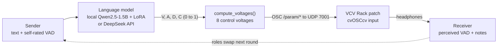

# A Machine for Misunderstanding

Two people try to talk to each other, but they can only use sound.

One person (the sender) writes a few sentences about how their body and mood feel right now, and rates their own feeling on three scales: valence, arousal and dominance (VAD). A language model reads the text and turns it into its own VAD estimate plus a confidence value. Those numbers drive a generative patch in VCV Rack. The other person (the receiver) sits apart, hears only the sound through headphones, and guesses what the sender felt. Then the roles swap.

The question I wanted to test: **when meaning has to pass through a machine and then through music, where does it get lost?** Is it the model reading the words, or the sound itself?

**Read the full report:** https://rex188.github.io/Machine-for-Misunderstanding/
(the source is [`blind_test/web/report.html`](blind_test/web/report.html); a Markdown version is in [`LAB_REPORT.md`](LAB_REPORT.md))

Project 2 of my Music Technology portfolio. Author: Rex Li.

---

## How it works



1. **Text in.** The sender types in a browser page (`blind_test/web/`) and sets three sliders for their own VAD.
2. **Text to numbers.** The model returns only a JSON object: `valence`, `arousal`, `dominance`, `confidence`, each between 0 and 1 (`blind_test/real_model.py`). There are two backends: a local Qwen2.5-1.5B-Instruct with a LoRA adapter I fine-tuned (`training/`), and the DeepSeek chat API.
3. **Numbers to voltages.** `compute_voltages()` in `blind_test/acoustic_bridge.py` maps the VAD values to 8 control voltages (timbre, frequency, amplitude, envelope, mode, chord, type, noise).
4. **Voltages to sound.** `blind_test/real_osc.py` sends them as OSC messages (`/param/timbre`, `/param/frequency`, ...) to `127.0.0.1:7001`. In VCV Rack, a `cvOSCcv` module receives them and modulates the patch [`workflow/generative template new mvp.vcv`](workflow/) (Plaits, an arpeggiator, Plateau reverb, drums and a mixer). The sound runs continuously, it is not a short clip.
5. **Sound back to numbers.** The receiver rates the VAD they heard and writes a short note. Nothing about the sender's text or the model output is shown to them until the end.

---

## The experiment

The test is double-blind (`BLIND_TEST_PLAN.md`, `BLIND_TEST_STATE_MACHINE.md`). The receiver cannot see the sender's text, the sender's self-rating, or the model output. Roles swap each round. Only after the last round does the "revelation" screen show both people everything.

I measure three distances in VAD space, each normalised to 0 to 1:

| Metric | Between | What it captures |
|---|---|---|
| `d_model` | sender self-rating and model output | how well the model read the words |
| `d_medium` | model output and receiver rating | how much the sound changed the meaning |
| `d_total` | sender self-rating and receiver rating | overall misunderstanding |

The code for this is in `blind_test/metrics.py`. Every round is stored in SQLite (`blind_test/schema.sql`, `blind_test/db.py`).

### What I found

From the report (10 sessions, 31 rounds in total; the tables use 5 representative sessions, 21 rounds):

- **The sound lost more meaning than the model did.** Mean `d_model` was 0.1980 and mean `d_medium` was 0.2984. The report states `d_medium > d_model` in 80% of sessions.
- **Kind messages could sound threatening.** In one 6-round session, the sender wrote *"Your dream will come true."* The receiver heard something "a little scary and uncertain". Later in the same session the receiver wrote: *"He def wanna comfort me because the audio sounds deadass creepy."* ([CASE_STUDIES.md](CASE_STUDIES.md))
- **People can learn to steer the sound.** In Session 3, the sender switched from describing a mood ("I am expecting some coffee") to giving the sound direct instructions ("Add more beat and make it cheerful"). `d_total` dropped from 0.563 in round 0 to 0.165 in round 3.
- **A bigger model did not fix it.** In a 4-round comparison, the DeepSeek API had a lower model gap than my local LoRA model (0.1587 vs 0.2162) and was faster (858 ms vs 4403 ms), but the medium gap was still 0.2161.

This is a small sample, so I read these as observations, not general proof. VAD also flattens feelings into three numbers. `LAB_REPORT.md` section 3.1 discusses this limit.

Run plots for the sessions are in `blind_test/web/media/` and are shown in the report.

---

## Repository map

| Path | What is there |
|---|---|
| `LAB_REPORT.md` | Full research report (Markdown) |
| `CASE_STUDIES.md` | Round-by-round logs of two sessions |
| `BLIND_TEST_PLAN.md` | Design and spec of the double-blind system |
| `BLIND_TEST_STATE_MACHINE.md`, `BLIND_TEST_DATA_SCHEMA.md` | Session state machine and data schema |
| `index.html` | Redirects GitHub Pages to the report |
| `blind_test/` | The experiment system: HTTP server, state machine, SQLite storage, model and OSC backends, browser UI, tests |
| `blind_test/web/report.html` | The web version of the report |
| `blind_test/data/` | Run plots and data notes from the October 3 sessions |
| `workflow/` | The earlier sound engine: text to VAD to OSC drivers, Max 9 interface (`max_interface.maxpat`), VCV patches, patching guide (`workflow/docs/`, Chinese), run log |
| `training/` | LoRA fine-tuning and evaluation scripts for Qwen2.5-1.5B (guide in Chinese) |
| `archive/` | Early notes, drafts and test patches, kept for the process record |

---

## Running it

You need VCV Rack 2 with the plugins used in the patch, including trowaSoft `cvOSCcv` listening on port 7001. The launch scripts were written for macOS.

**Tests** (standard library only, plus pytest):

```bash
cd blind_test
python3 -m pytest -q
```

**Blind test session** (see [`blind_test/PERFORMANCE_QUICKSTART.md`](blind_test/PERFORMANCE_QUICKSTART.md) and [`blind_test/TWO_LAPTOP_QUICKSTART.md`](blind_test/TWO_LAPTOP_QUICKSTART.md), both in Chinese):

```bash
# 1. open workflow/generative template new mvp.vcv in VCV Rack
# 2. start the API server (7070) and web UI (8080)
cd blind_test
./launch_performance.sh          # optional: ./launch_performance.sh 4  (max rounds)
# 3. open the two browser windows, enter the Session ID and tokens printed in the terminal
```

If `DEEPSEEK_API_KEY` is set, the session uses the DeepSeek API. Otherwise it loads the local Qwen + LoRA model. The LoRA weights and training data are not in this repo (they are listed in `.gitignore`), so the local backend needs you to train or supply your own adapter (`training/README.md`).

**Sound engine on its own** (see [`workflow/QUICKSTART.md`](workflow/QUICKSTART.md)):

```bash
./start.sh                                   # web controller on http://127.0.0.1:7070
# or, from workflow/:
python3 llm_sound_interactive.py             # interactive terminal driver
python3 seq_to_osc.py --watch seq_input.txt  # loop driver used with the Max UI
```

---

## References

- McLuhan, M. (1964). *Understanding Media: The Extensions of Man*. McGraw-Hill.
- Mehrabian, A., & Russell, J. A. (1974). *An Approach to Environmental Psychology*. The MIT Press.
- Russell, J. A. (1980). A circumplex model of affect. *Journal of Personality and Social Psychology*, 39(6), 1161–1178.
