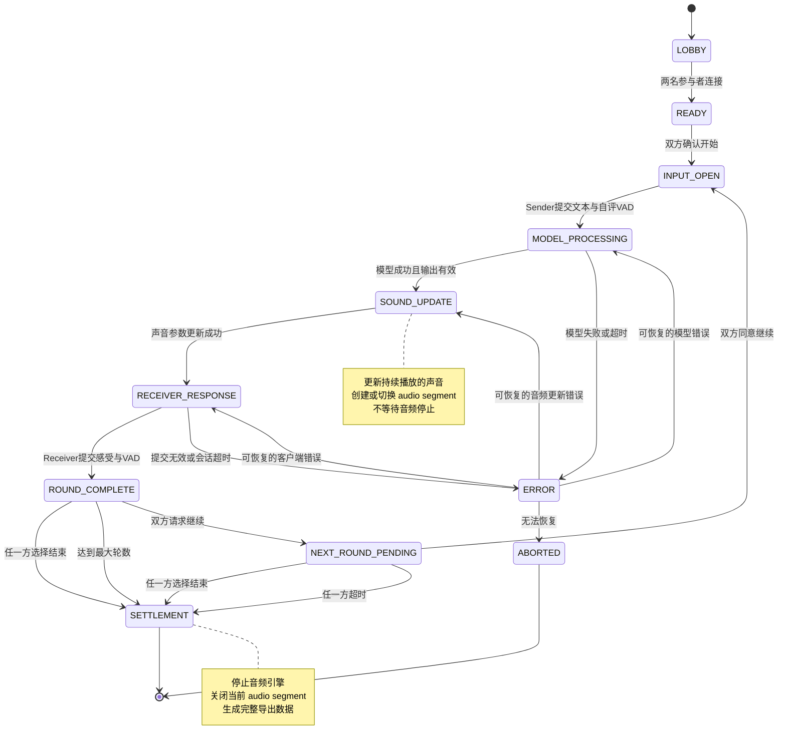
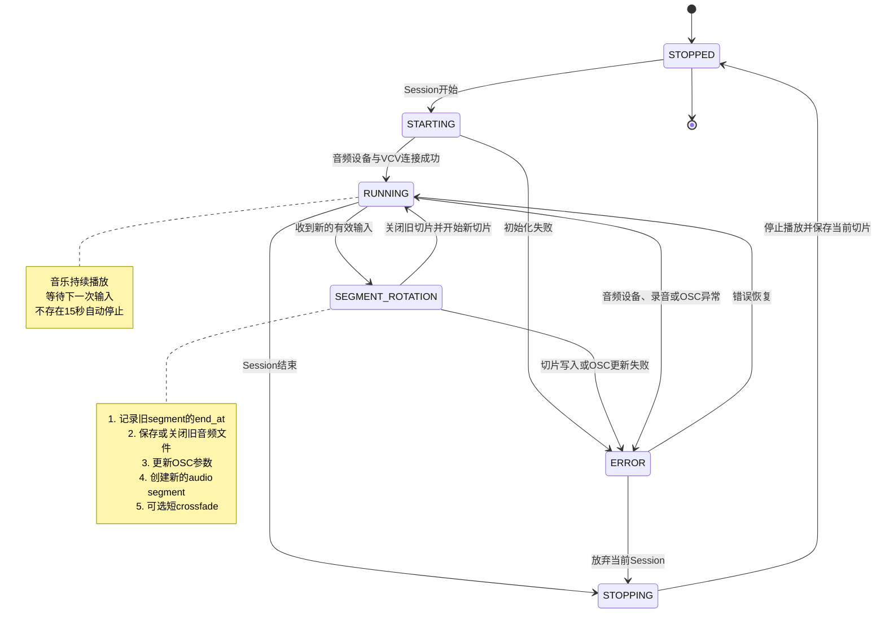

## 核心原则

- Session 状态由服务器决定；
- 客户端只能提交事件，不能直接改状态；
- 发送者和接收者看到的是同一个服务器状态的不同投影；
- 每一轮只包含一次声音传输；
- 任意一方可以结束，但继续下一轮必须双方同意。
- 音频引擎在 session 开始后持续运行；
- 下一次有效输入会改变声音参数；
- 音频切片只用于数据记录，不作为交互阻塞条件；
- 接收者不需要等待音频停止；
- 实验轮次仍然必须顺序完成；
- 前端倒计时、音频结束事件和固定播放时长全部删除。
---
## 一轮的定义

> 一轮 =
Sender提交文本与自评VAD
→ 模型解释
→ 声音参数更新
→ Receiver提交听觉感受与VAD
→ 本轮完成
## Workflow

### 实验SM和音频SM

状态机关系

实验状态机进入 SOUND_UPDATE
        ↓
音频状态机收到“更新声音”事件
        ↓
执行 SEGMENT_ROTATION
        ↓
返回 RUNNING
        ↓
实验状态机进入 RECEIVER_RESPONSE

Round 1:
A sender → B receiver

Round 2:
B sender → A receiver

Round 3:
A sender → B receiver

每轮角色写进日志，避免后续重建错误。